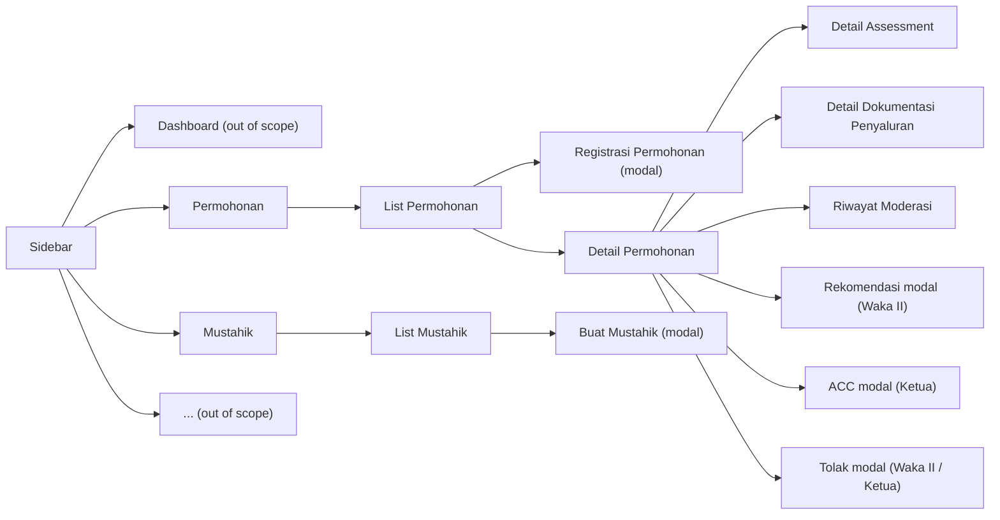
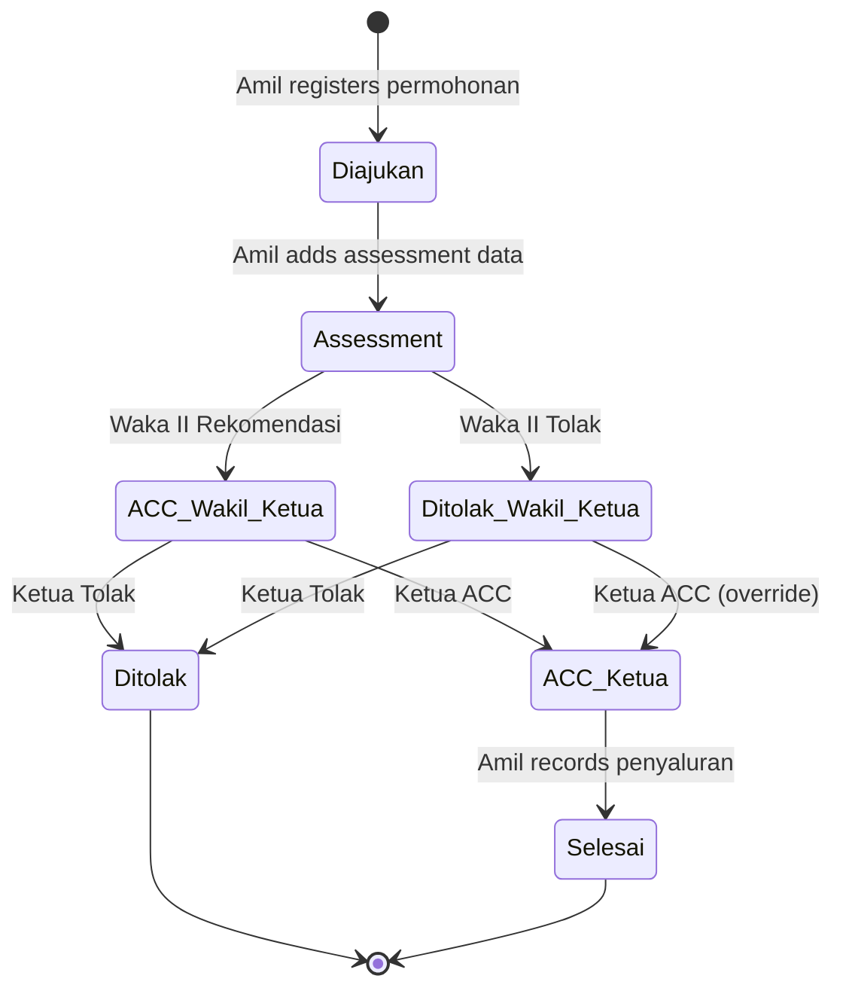
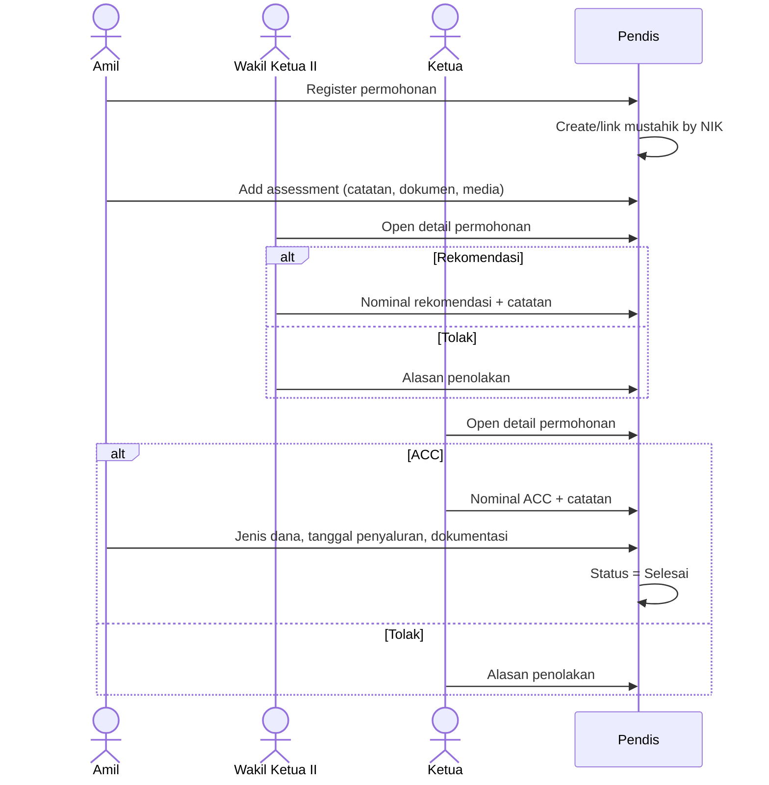
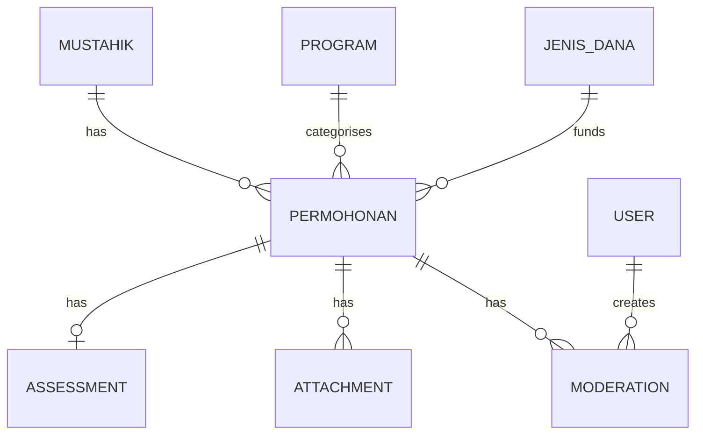

# PRD: Aplikasi Pendistribusian (Pendis) BAZNAS

| | |
|---|---|
| **Document status** | Draft v1.0 |
| **Last updated** | 7 November 2026 |
| **Sources** | `draft.md`, `wireframe/*.png`, `wireframe/wireframe aplikasi pendis.figcraft` |
| **Platform** | Web application (desktop-first) |

---

## 1. Overview

### 1.1 Background

Amil at BAZNAS process assistance requests (*permohonan bantuan*) from prospective beneficiaries (*mustahik*). Each request goes through registration, field assessment, leadership moderation and, if approved, fund distribution (*penyaluran*). This process currently lacks a single system that stores request data, supporting documents, leadership decisions and distribution evidence in one place.

### 1.2 Product summary

Pendis is a web application for amil work at BAZNAS. It lets users:

1. Register new assistance requests (permohonan).
2. Store assessment data (notes, documents and media) for each request.
3. Run a two-level leadership moderation: a **recommendation by Wakil Ketua II** followed by **approval (ACC) or rejection by the Ketua**.
4. Record distribution details and distribution documentation (dokumentasi penyaluran).
5. View all requests and all mustahik data.
6. Maintain a mustahik database, populated either manually or automatically from requests.

### 1.3 Goals

- Digitise the full request lifecycle from registration to distribution.
- Give leadership a clear, auditable moderation flow with a complete decision history.
- Build a reusable, deduplicated mustahik database.
- Make every request searchable and its current status visible at a glance.

### 1.4 Non-goals (this version)

- Dashboard content (menu item exists in wireframes but is not specified).
- Additional menu items shown as `...` in the sidebar.
- Public/self-service request submission by mustahik.
- Fund collection (*penghimpunan*) and accounting/finance integration.
- Native mobile apps.

---

## 2. Glossary

| Term | Meaning |
|---|---|
| **Amil** | BAZNAS staff who manage zakat collection and distribution. Primary operator of the app. |
| **Mustahik** | Eligible recipient of zakat/assistance. |
| **Permohonan** | Assistance request submitted on behalf of a mustahik. |
| **PM (Penerima Manfaat)** | Beneficiary. "Jumlah PM" = number of beneficiaries covered by the request. |
| **Asnaf** | Category of zakat recipient (Fakir, Miskin, Amil, Mualaf, Riqab, Gharim, Fisabilillah, Ibnu Sabil). |
| **Lembaga Referrer** | Referring institution, e.g. a UPZ (Unit Pengumpul Zakat). |
| **Program** | BAZNAS distribution programme, e.g. Cianjur Makmur, Cianjur Takwa, Cianjur Cerdas, Cianjur Sehat, Cianjur Peduli. |
| **Perihal** | Subject/purpose of the request, e.g. "Bantuan modal usaha awal". |
| **Assessment** | Field verification by amil: notes, documents and photos. |
| **Waka II (Wakil Ketua II)** | Deputy chair responsible for distribution; gives the first-level recommendation. |
| **Ketua** | Chair; gives the final decision. |
| **Rekomendasi** | Waka II's positive decision, including a recommended amount. |
| **ACC** | Approval (*accept*) by Ketua, including the approved amount (*Nominal ACC*). |
| **Tolak / Ditolak** | Reject / rejected. |
| **Jenis Dana** | Source fund type, e.g. Zakat, Infak Terikat, Infak Tidak Terikat. |
| **Penyaluran** | Distribution of approved funds to the mustahik. |

---

## 3. Users and roles

| Role | Description | Key permissions |
|---|---|---|
| **Amil** | Operational staff | Create/edit permohonan, manage assessment, set jenis dana and tanggal penyaluran, upload dokumentasi penyaluran, create mustahik, print. |
| **Wakil Ketua II** | First-level moderator | View permohonan and assessment, give **Rekomendasi** (with nominal) or **Tolak** (with reason), update own decision via Riwayat Moderasi. |
| **Ketua** | Final approver | View permohonan, assessment and Waka II decision, give **ACC** (with nominal) or **Tolak** (with reason), update own decision via Riwayat Moderasi, print. |

> All roles can view the Permohonan list and Mustahik list. Moderators see request data as read-only.

---

## 4. Information architecture

Layout: fixed left sidebar (Dashboard, Permohonan, Mustahik, `...`) with the active item outlined; main content panel on the right; primary actions as rounded buttons at the bottom right.

---

## 5. Request lifecycle

### 5.1 Status values

Statuses visible in the Permohonan list:

| Status | Meaning |
|---|---|
| **Diajukan** | Request registered, awaiting assessment. |
| **Assessment** | Assessment in progress (notes/documents/media being collected). |
| **ACC Wakil Ketua** | Waka II has given a recommendation; awaiting Ketua. |
| **Ditolak Wakil Ketua** | Waka II rejected; still awaiting Ketua's final decision. *(Inferred, see Open Questions.)* |
| **ACC Ketua** | Ketua approved; awaiting distribution. |
| **Ditolak** | Ketua rejected; final. *(Inferred, see Open Questions.)* |
| **Selesai** | Funds distributed and documented. |

### 5.2 State diagram

> [!NOTE]
> Wireframes show that a Waka II rejection does **not** end the process: the Ketua still sees **TOLAK** and **ACC** buttons on a request where Waka II's decision is "Ditolak". The Ketua therefore always makes the final decision.

### 5.3 Moderation sequence

---

## 6. Functional requirements

Requirement IDs use the format `FR-<area>-<n>`. Priority: **P0** must have for launch, **P1** should have, **P2** nice to have.

### 6.1 List Permohonan

Wireframe: `list permohonan.png`

| ID | Requirement | Priority |
|---|---|---|
| FR-LP-1 | Display a table of all permohonan with columns: **No.**, **Tanggal**, **No. Register**, **Nama Pemohon**, **Program**, **Perihal**, **Nominal ACC**, **Status**. | P0 |
| FR-LP-2 | Default sort by Tanggal descending (newest first). | P0 |
| FR-LP-3 | Free-text search box ("Pencarian...") filtering across No. Register, Nama Pemohon, Program, Perihal and Status. | P0 |
| FR-LP-4 | Long text (e.g. Perihal) is truncated with an ellipsis; full text shown on hover. | P1 |
| FR-LP-5 | Nominal displayed in Rupiah format `Rp. 20.000.000,-`. Empty until a nominal exists. | P0 |
| FR-LP-6 | Clicking a row opens **Detail Permohonan**. | P0 |
| FR-LP-7 | **BARU** button (bottom right) opens the Registrasi Permohonan modal. Visible to Amil only. | P0 |
| FR-LP-8 | Table is scrollable / paginated for large datasets. | P0 |

> [!NOTE]
> "Nominal ACC" should show the Ketua's approved amount once available. Before that, it may show the Waka II recommended amount (see Open Questions).

### 6.2 Registrasi Permohonan Bantuan (create)

Wireframe: `create permohonan.png` (modal over the list)

| ID | Requirement | Priority |
|---|---|---|
| FR-CP-1 | Modal titled **REGISTRASI PERMOHONAN BANTUAN** with fields listed in §7.1. | P0 |
| FR-CP-2 | **BATAL** closes the modal without saving; confirm if the form has unsaved input. | P0 |
| FR-CP-3 | **SIMPAN** validates and saves the request with status **Diajukan** and Tanggal = creation date. | P0 |
| FR-CP-4 | On save, the system looks up a mustahik by **NIK Pemohon**. If none exists, a new mustahik is **created automatically** from the request data; otherwise the request is linked to the existing mustahik. | P0 |
| FR-CP-5 | Typing a NIK that matches an existing mustahik offers to auto-fill the remaining applicant fields. | P1 |
| FR-CP-6 | No. Register is unique. The system should auto-generate it (see Open Questions) while still displaying it in the form. | P0 |
| FR-CP-7 | Jenis Kelamin, Jenis Asnaf, Program, Lembaga Referrer, Kelurahan and Kecamatan use dropdowns backed by master data. | P1 |

### 6.3 Detail Permohonan (Amil view)

Wireframe: `detail permohonan.png`

| ID | Requirement | Priority |
|---|---|---|
| FR-DP-1 | Show all request fields (§7.1) plus Tanggal as a label/value list titled **DETAIL PERMOHONAN**. | P0 |
| FR-DP-2 | Each editable field has an edit (pencil) icon enabling inline editing. No. Register and Tanggal are read-only. | P0 |
| FR-DP-3 | **Assessment** row shows a summary (e.g. "2 Document(s), 3 Media(s)") and a **Detail** link to Detail Assessment. | P0 |
| FR-DP-4 | **Moderasi Wakil Ketua II** row shows the decision (green **Rekomendasi** or red **Ditolak**), the nominal (if recommended) and a **Detail** link to Riwayat Moderasi. Hidden/empty if no decision yet. | P0 |
| FR-DP-5 | **Moderasi Ketua** row shows the decision (green **ACC** or red **Ditolak**), the nominal (if ACC) and a **Detail** link to Riwayat Moderasi. | P0 |
| FR-DP-6 | **Jenis Dana** dropdown (e.g. Infak Tidak Terikat). Editable once the request is ACC Ketua. | P0 |
| FR-DP-7 | **Tanggal Penyaluran** with a date picker; shows "(belum ada)" when empty. Editable once ACC Ketua. | P0 |
| FR-DP-8 | **Dokumentasi Penyaluran** row shows a summary (e.g. "10 Media(s)") and a **Detail** link. | P0 |
| FR-DP-9 | Bottom actions: **BATAL** (discard changes and return to list), **Cetak** (print), **SIMPAN** (save changes). | P0 |
| FR-DP-10 | When Jenis Dana, Tanggal Penyaluran and at least one dokumentasi penyaluran exist on an ACC Ketua request, status becomes **Selesai**. | P0 |
| FR-DP-11 | Editing applicant data after moderation has started is restricted (see Open Questions). | P1 |

### 6.4 Detail Assessment

Wireframe: `detail assessment.png`

| ID | Requirement | Priority |
|---|---|---|
| FR-AS-1 | Header shows **No. Register** and **Nama** of the request. | P0 |
| FR-AS-2 | **Catatan** textarea ("Catatan Assessment..") with **Simpan** and **Ubah** buttons. Saved notes are read-only until **Ubah** is clicked. | P0 |
| FR-AS-3 | **Dokumen** section: upload, view/download and delete document files (DOC, DOCX, PDF). | P0 |
| FR-AS-4 | **Media** section: upload, preview and delete images (JPG, PNG). | P0 |
| FR-AS-5 | **Tiles / List** toggle switches the file display mode. | P1 |
| FR-AS-6 | Adding the first assessment item moves status from **Diajukan** to **Assessment**. | P0 |
| FR-AS-7 | Moderators can view (read-only) assessment data. | P0 |

### 6.5 Detail Dokumentasi Penyaluran

Wireframe: `detail dokumentasi penyaluran.png`

| ID | Requirement | Priority |
|---|---|---|
| FR-DD-1 | Header shows **No. Register** and **Nama**. | P0 |
| FR-DD-2 | **Dokumen** section (e.g. handover receipt, BAST) and **Media** section (distribution photos) with upload, preview/download and delete. | P0 |
| FR-DD-3 | **Tiles / List** toggle. | P1 |
| FR-DD-4 | Upload is only enabled when status is **ACC Ketua** or **Selesai**. | P0 |

### 6.6 Moderasi Wakil Ketua II

Wireframes: `detail permohonan pov waka 2.png`, `create rekomendasi pov waka 2.png`, `detail permohonan create tolak pov waka 2.png`

| ID | Requirement | Priority |
|---|---|---|
| FR-W2-1 | Waka II sees Detail Permohonan **read-only** with Assessment summary and Detail link. | P0 |
| FR-W2-2 | Bottom actions: **BATAL**, **TOLAK**, **REKOMENDASI**. Shown only when status is **Assessment** (or **Diajukan**, see Open Questions) and Waka II has not decided yet. | P0 |
| FR-W2-3 | **REKOMENDASI** opens a modal with **Nominal Rekomendasi** (Rp, numeric, required, > 0) and **Catatan** (optional). **SIMPAN** saves; **BATAL** closes. | P0 |
| FR-W2-4 | **TOLAK** opens a modal with **Alasan Penolakan** (required). **SIMPAN** saves; **BATAL** closes. | P0 |
| FR-W2-5 | After saving, status becomes **ACC Wakil Ketua** (rekomendasi) or **Ditolak Wakil Ketua** (tolak), and a history entry is recorded with timestamp and user. | P0 |

### 6.7 Moderasi Ketua

Wireframes: `detail permohonan rekomendasi waka 2.png`, `detail permohonan ditolak waka 2 pov.png`, `detail permohonan create acc ketua.png`, `detail permohonan create tolak pov ketua.png`

| ID | Requirement | Priority |
|---|---|---|
| FR-KT-1 | Ketua sees Detail Permohonan read-only including the **Moderasi Wakil Ketua II** row (decision, nominal, Detail link). | P0 |
| FR-KT-2 | Bottom actions: **BATAL**, **TOLAK**, **ACC**. Available after Waka II has decided, regardless of whether Waka II recommended or rejected. | P0 |
| FR-KT-3 | **ACC** opens a modal with **Nominal ACC** (Rp, required, > 0; pre-filled with Waka II's recommended nominal when available) and **Catatan** (optional). | P0 |
| FR-KT-4 | **TOLAK** opens a modal with **Alasan Penolakan** (required). | P0 |
| FR-KT-5 | After saving, status becomes **ACC Ketua** or **Ditolak**, Nominal ACC is shown in the list, and a history entry is recorded. | P0 |

### 6.8 Hasil Moderasi (final views)

Wireframes: `detail permohonan approved ketua.png`, `detail permohonan ditolak ketua.png`

| ID | Requirement | Priority |
|---|---|---|
| FR-HM-1 | Approved request shows both moderation rows (Waka II Rekomendasi + nominal, Ketua ACC + nominal) in green, each with a Detail link. | P0 |
| FR-HM-2 | Rejected request shows the rejecting decision(s) as red **Ditolak** with Detail links. | P0 |
| FR-HM-3 | Actions: **BATAL** (back) and **Cetak** (print). | P0 |

### 6.9 Riwayat Moderasi

Wireframes: `riwayat moderasi pov waka 2.png`, `riwayat moderasi pov ketua.png`

| ID | Requirement | Priority |
|---|---|---|
| FR-RM-1 | Page titled **RIWAYAT MODERASI** with header: No. Register, Nama Pemohon, Tanggal. | P0 |
| FR-RM-2 | Chronological list of all moderation events. Each entry shows timestamp (`15 Oktober 2026, 10:12:54 WIB`), actor + decision (e.g. "Waka II Rekomendasi", "Ketua ACC", "Ketua Tolak") and nominal where applicable. Catatan/alasan viewable per entry. | P0 |
| FR-RM-3 | History is **append-only**: updates create new entries; previous entries are never edited or deleted (e.g. "Ketua ACC Rp 60.000.000" followed by "Ketua ACC Rp 65.000.000"). | P0 |
| FR-RM-4 | Waka II sees **BATAL**, **Update Tolak**, **Update Rekomendasi** to revise their own decision. | P0 |
| FR-RM-5 | Ketua sees **BATAL**, **Update Tolak**, **Update ACC** to revise their own decision. | P0 |
| FR-RM-6 | The latest entry per role is the effective decision and drives status and displayed nominal. | P0 |
| FR-RM-7 | Amil can view history read-only (no update buttons). | P0 |
| FR-RM-8 | Updates are locked once the request is **Selesai** (see Open Questions for Waka II updates after Ketua decision). | P1 |

### 6.10 Cetak (print)

| ID | Requirement | Priority |
|---|---|---|
| FR-CT-1 | **Cetak** produces a printable / PDF document of the request containing applicant data, assessment summary, moderation decisions with nominals and distribution details. | P1 |
| FR-CT-2 | Print layout uses BAZNAS letterhead (exact template to be provided). | P2 |

### 6.11 List Mustahik

Wireframe: `list mustahik.png`

| ID | Requirement | Priority |
|---|---|---|
| FR-LM-1 | Table of all mustahik with columns: **No.**, **Nama Mustahik**, **Nama Jalan/Kampung/Gang**, **Kelurahan**, **Kecamatan**, **Pekerjaan**, **Umur**, **Asnaf**. | P0 |
| FR-LM-2 | **Umur** is calculated from tanggal lahir; shows "-" if unknown. | P0 |
| FR-LM-3 | Free-text search across name, NIK, address, pekerjaan and asnaf. | P0 |
| FR-LM-4 | **BARU** button opens the Buat Mustahik modal. | P0 |
| FR-LM-5 | Lists mustahik created manually and those created automatically from permohonan. | P0 |
| FR-LM-6 | Clicking a row opens mustahik detail with their request history. | P2 |

### 6.12 Buat Mustahik (create)

Wireframe: `create mustahik.png`

| ID | Requirement | Priority |
|---|---|---|
| FR-CM-1 | Modal titled **MEMBUAT DATA MUSTAHIK BARU** with fields listed in §7.2. | P0 |
| FR-CM-2 | **TTL** uses a date picker. | P0 |
| FR-CM-3 | NIK must be unique; saving a duplicate NIK shows an error linking to the existing record. | P0 |
| FR-CM-4 | **BATAL** closes without saving; **SIMPAN** validates and saves. | P0 |

---

## 7. Data model

### 7.1 Permohonan

| Field | Type | Required | Notes |
|---|---|---|---|
| No. Register | string | Yes | Unique, auto-generated. |
| Tanggal | date | Yes | Auto-set at creation. |
| Nama Pemohon | string | Yes | |
| NIK Pemohon | string(16) | Yes | 16 digits; used to link mustahik. |
| Jenis Kelamin | enum | Yes | Laki-laki, Perempuan. |
| Nama Jalan/Kampung/Gang | string | Yes | Including RT/RW. |
| Kelurahan | string / ref | Yes | |
| Kecamatan | string / ref | Yes | |
| Lembaga Referrer | string / ref | No | e.g. UPZ Pinang. |
| Status Pekerjaan/Usaha/Sekolah PM | string | Yes | e.g. Pedagang Bakso. |
| Penghasilan PM per Bulan | integer (Rp) | Yes | |
| Kontak | string | Yes | Phone number. |
| Jenis Asnaf | enum | Yes | 8 asnaf. |
| Jumlah Penerima Manfaat | integer | Yes | ≥ 1. |
| Perihal | string | Yes | |
| Program | ref | Yes | |
| Jenis Dana | enum / ref | After ACC | e.g. Zakat, Infak Terikat, Infak Tidak Terikat. |
| Tanggal Penyaluran | date | After ACC | |
| Status | enum | Yes | See §5.1. |
| Mustahik ID | ref | Yes | Linked via NIK. |

### 7.2 Mustahik

| Field | Type | Required | Notes |
|---|---|---|---|
| Nama Mustahik | string | Yes | |
| NIK | string(16) | Yes | Unique. |
| Jenis Kelamin | enum | Yes | |
| TTL (Tanggal Lahir) | date | No* | *Required on manual create; may be empty when auto-created from permohonan. |
| Nama Jalan/Kampung/Gang | string | Yes | |
| Kelurahan | string / ref | Yes | |
| Kecamatan | string / ref | Yes | |
| Status Pekerjaan/Usaha/Sekolah | string | Yes | Shown as "Pekerjaan" in list. |
| Penghasilan per Bulan | integer (Rp) | Yes | |
| Kontak | string | Yes | |
| Jenis Asnaf | enum | Yes | |
| Source | enum | Yes | Manual / Permohonan. |

### 7.3 Supporting entities

| Entity | Key fields |
|---|---|
| **Assessment** | permohonan_id, catatan, updated_by, updated_at |
| **Attachment** | permohonan_id, category (assessment / penyaluran), kind (dokumen / media), file name, mime type, size, uploaded_by, uploaded_at |
| **Moderation** | permohonan_id, role (Waka II / Ketua), decision (Rekomendasi / ACC / Tolak), nominal, catatan / alasan, user_id, created_at (WIB) |
| **User** | name, email/username, password hash, role |
| **Master data** | Program, Jenis Dana, Jenis Asnaf, Lembaga Referrer, Kecamatan, Kelurahan |

---

## 8. Business rules

1. **BR-1** A mustahik is uniquely identified by NIK. A permohonan always links to exactly one mustahik.
2. **BR-2** Creating a permohonan with an unknown NIK automatically creates a mustahik (Source = Permohonan).
3. **BR-3** Moderation order is fixed: Waka II first, then Ketua. Ketua cannot decide before Waka II.
4. **BR-4** Ketua's decision is final and may override a Waka II rejection.
5. **BR-5** Rekomendasi and ACC require a nominal greater than 0. Tolak requires a reason.
6. **BR-6** Moderation history is append-only; the latest entry per role is effective.
7. **BR-7** Distribution data (Jenis Dana, Tanggal Penyaluran, Dokumentasi Penyaluran) can only be entered on ACC Ketua requests.
8. **BR-8** All monetary values are in Rupiah, stored as integers and displayed as `Rp. 60.000.000,-`.
9. **BR-9** Dates are displayed in Indonesian (`15 Oktober 2026`) and timestamps in WIB.

---

## 9. Non-functional requirements

| Area | Requirement |
|---|---|
| **Authentication** | Username/password login; sessions expire after inactivity. |
| **Authorisation** | Role-based access enforced server-side (§3), not just hidden buttons. |
| **Audit** | Record who created/updated permohonan, assessment, attachments and moderation, with timestamps. |
| **Privacy** | NIK, contact and income are personal data; restrict access to logged-in users and use HTTPS. Comply with UU PDP (UU No. 27/2022). |
| **File uploads** | Allowed types: PDF, DOC, DOCX, JPG, JPEG, PNG. Max 10 MB per file (configurable). Images get thumbnails. |
| **Performance** | List pages load in under 2 seconds with 10,000 records; search responds in under 1 second. |
| **Browser support** | Latest Chrome, Edge, Firefox and Safari; desktop-first, usable at 1366×768. |
| **Language** | UI in Bahasa Indonesia. |
| **Backup** | Daily database and file storage backups. |

---

## 10. Success metrics

- 100% of new permohonan registered in Pendis within 1 month of launch.
- Median time from registration to Ketua decision is measurable and reported.
- Zero duplicate mustahik records by NIK.
- Every Selesai request has at least one dokumentasi penyaluran file.

---

## 11. Open questions

| # | Question | Context |
|---|---|---|
| 1 | How is **No. Register** generated (format, sequence, reset yearly)? | Shown as an input on the create form; all examples are `12345`. |
| 2 | Is **Ditolak Wakil Ketua** a distinct list status? What status label is used for a final Ketua rejection? | List wireframe only shows Diajukan, Assessment, ACC Wakil Ketua, ACC Ketua, Selesai. |
| 3 | Can Waka II moderate a request still in **Diajukan** (no assessment yet), or is assessment mandatory first? | |
| 4 | Can Waka II update their decision **after** Ketua has decided? If so, does Ketua need to re-decide? | Riwayat Moderasi (Waka II view) shows Update buttons even after Ketua ACC. |
| 5 | Can Ketua ACC an amount **different** from Waka II's recommendation? | Assumed yes; nominal is editable in the ACC modal. |
| 6 | Should "Nominal ACC" in the list show the Waka II recommended amount before Ketua decides? | Row 3 ("ACC Wakil Ketua") shows a nominal. |
| 7 | Which fields can Amil still edit once moderation has started or the request is approved? | Detail page shows edit icons on all fields. |
| 8 | What exactly does **Cetak** print (approval letter, disposition sheet, full report) and what template? | |
| 9 | When a mustahik is auto-created, should later permohonan **update** the mustahik's data (address, income, asnaf)? | |
| 10 | **TTL** shows only a date picker: is *tempat lahir* (place of birth) also required? Permohonan has no birth date, so auto-created mustahik have no Umur. | |
| 11 | Is there an Admin role for user management and master data (Program, Jenis Dana, Lembaga Referrer, wilayah)? | Not in wireframes. |
| 12 | Should moderators be notified (in-app, email, WhatsApp) when a request awaits their decision? | |
| 13 | Is it possible to edit or view mustahik details from the Mustahik list? | Only list and create are wireframed. |
| 14 | What should the Dashboard show? | Out of scope for now. |

---

## 12. Appendix: user flows to wireframes

| # | Flow | Wireframes |
|---|---|---|
| 1 | Create permohonan | `list permohonan.png` → `create permohonan.png` |
| 2 | View and edit permohonan | `list permohonan.png` → `detail permohonan.png` |
| 3 | Create assessment | `list permohonan.png` → `detail permohonan.png` → `detail assessment.png` |
| 4 | Create dokumentasi penyaluran | `list permohonan.png` → `detail permohonan.png` → `detail dokumentasi penyaluran.png` |
| 5 | Waka II recommends | `list permohonan.png` → `detail permohonan pov waka 2.png` → `create rekomendasi pov waka 2.png` |
| 6 | Waka II rejects | `list permohonan.png` → `detail permohonan pov waka 2.png` → `detail permohonan create tolak pov waka 2.png` |
| 7 | Ketua approves | `list permohonan.png` → `detail permohonan rekomendasi waka 2.png` → `detail permohonan create acc ketua.png` |
| 8 | Ketua rejects | `list permohonan.png` → `detail permohonan rekomendasi waka 2.png` / `detail permohonan ditolak waka 2 pov.png` → `detail permohonan create tolak pov ketua.png` |
| 9 | View approved result | `list permohonan.png` → `detail permohonan approved ketua.png` |
| 10 | View rejected result | `list permohonan.png` → `detail permohonan ditolak ketua.png` |
| 11 | Riwayat moderasi (Waka II) | `list permohonan.png` → `detail permohonan.png` → `riwayat moderasi pov waka 2.png` |
| 12 | Riwayat moderasi (Ketua) | `list permohonan.png` → `detail permohonan.png` → `riwayat moderasi pov ketua.png` |
| 13 | View mustahik list | `list mustahik.png` |
| 14 | Create mustahik | `list mustahik.png` → `create mustahik.png` |
