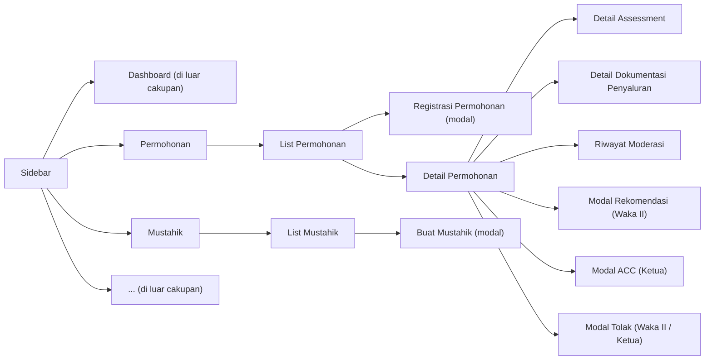
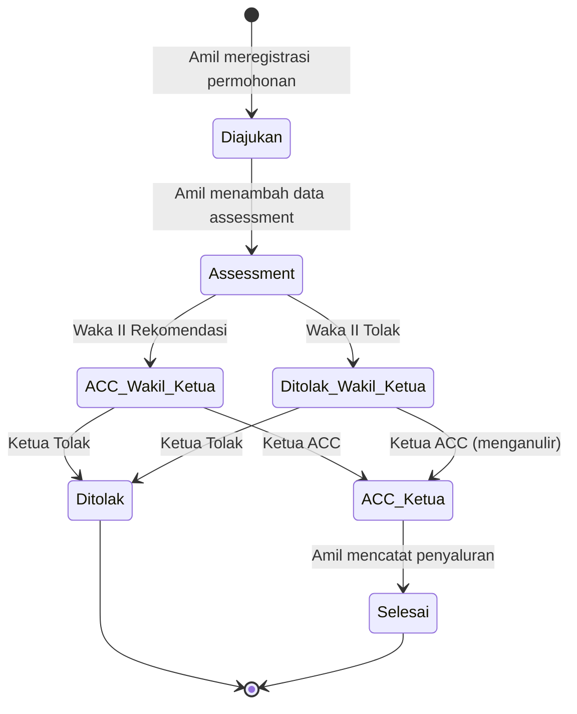
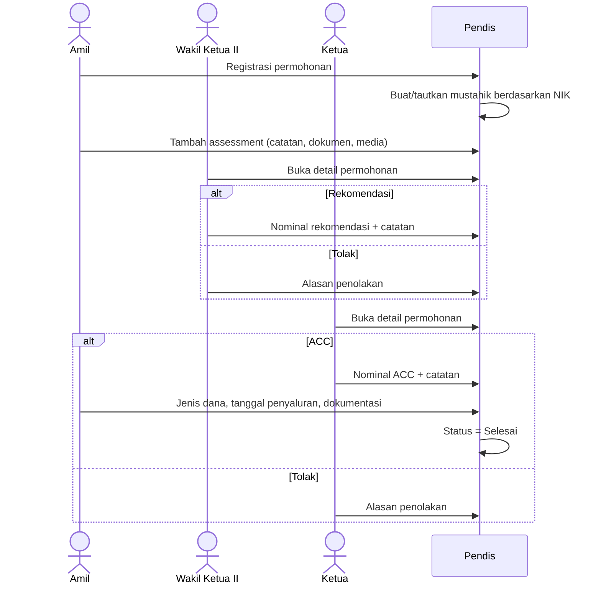
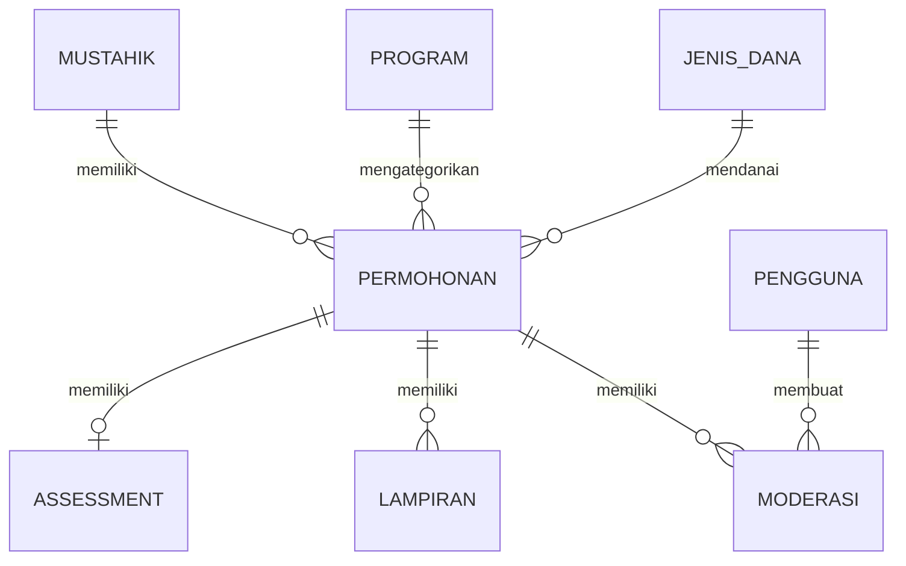

# PRD: Aplikasi Pendistribusian (Pendis) BAZNAS

| | |
|---|---|
| **Status dokumen** | Draf v1.0 |
| **Terakhir diperbarui** | 7 November 2026 |
| **Sumber** | `draft.md`, `wireframe/*.png`, `wireframe/wireframe aplikasi pendis.figcraft` |
| **Platform** | Aplikasi web (diutamakan desktop) |

---

## 1. Ringkasan

### 1.1 Latar belakang

Amil BAZNAS memproses permohonan bantuan dari calon penerima (*mustahik*). Setiap permohonan melalui tahap registrasi, assessment lapangan, moderasi pimpinan dan, jika disetujui, penyaluran dana. Saat ini belum ada satu sistem yang menyimpan data permohonan, dokumen pendukung, keputusan pimpinan dan bukti penyaluran di satu tempat.

### 1.2 Gambaran produk

Pendis adalah aplikasi berbasis web untuk pekerjaan amil di BAZNAS. Aplikasi ini memungkinkan pengguna untuk:

1. Meregistrasi permohonan bantuan baru.
2. Menyimpan data assessment (catatan, dokumen dan media) untuk setiap permohonan.
3. Menjalankan moderasi pimpinan dua tingkat: **rekomendasi oleh Wakil Ketua II** lalu **persetujuan (ACC) atau penolakan oleh Ketua**.
4. Mencatat detail penyaluran dan dokumentasi penyaluran.
5. Melihat seluruh data permohonan dan mustahik.
6. Mengelola basis data mustahik yang terbentuk dari input manual atau otomatis dari permohonan.

### 1.3 Tujuan

- Mendigitalkan seluruh siklus permohonan dari registrasi hingga penyaluran.
- Memberikan alur moderasi yang jelas dan dapat diaudit, lengkap dengan riwayat keputusan.
- Membangun basis data mustahik yang dapat digunakan ulang dan bebas duplikasi.
- Membuat setiap permohonan mudah dicari dan statusnya terlihat sekilas.

### 1.4 Di luar cakupan (versi ini)

- Isi Dashboard (menu ada di wireframe tetapi belum dispesifikasikan).
- Menu tambahan yang ditampilkan sebagai `...` di sidebar.
- Pengajuan permohonan mandiri oleh mustahik secara publik.
- Penghimpunan dana dan integrasi akuntansi/keuangan.
- Aplikasi mobile native.

---

## 2. Glosarium

| Istilah | Arti |
|---|---|
| **Amil** | Petugas BAZNAS yang mengelola penghimpunan dan penyaluran zakat. Operator utama aplikasi. |
| **Mustahik** | Penerima zakat/bantuan yang berhak. |
| **Permohonan** | Pengajuan bantuan atas nama mustahik. |
| **PM (Penerima Manfaat)** | Penerima manfaat. "Jumlah PM" = jumlah penerima manfaat yang tercakup dalam permohonan. |
| **Asnaf** | Golongan penerima zakat (Fakir, Miskin, Amil, Mualaf, Riqab, Gharim, Fisabilillah, Ibnu Sabil). |
| **Lembaga Referrer** | Lembaga yang merujuk, misalnya UPZ (Unit Pengumpul Zakat). |
| **Program** | Program penyaluran BAZNAS, misalnya Cianjur Makmur, Cianjur Takwa, Cianjur Cerdas, Cianjur Sehat, Cianjur Peduli. |
| **Perihal** | Pokok/tujuan permohonan, misalnya "Bantuan modal usaha awal". |
| **Assessment** | Verifikasi lapangan oleh amil: catatan, dokumen dan foto. |
| **Waka II (Wakil Ketua II)** | Wakil ketua bidang pendistribusian; memberi rekomendasi tingkat pertama. |
| **Ketua** | Ketua; memberi keputusan akhir. |
| **Rekomendasi** | Keputusan positif Waka II, disertai nominal yang direkomendasikan. |
| **ACC** | Persetujuan Ketua, disertai nominal yang disetujui (*Nominal ACC*). |
| **Tolak / Ditolak** | Menolak / ditolak. |
| **Jenis Dana** | Sumber dana, misalnya Zakat, Infak Terikat, Infak Tidak Terikat. |
| **Penyaluran** | Penyerahan dana yang disetujui kepada mustahik. |

---

## 3. Pengguna dan peran

| Peran | Deskripsi | Hak akses utama |
|---|---|---|
| **Amil** | Staf operasional | Membuat/mengubah permohonan, mengelola assessment, mengisi jenis dana dan tanggal penyaluran, mengunggah dokumentasi penyaluran, membuat mustahik, mencetak. |
| **Wakil Ketua II** | Moderator tingkat pertama | Melihat permohonan dan assessment, memberi **Rekomendasi** (dengan nominal) atau **Tolak** (dengan alasan), memperbarui keputusannya melalui Riwayat Moderasi. |
| **Ketua** | Pemberi persetujuan akhir | Melihat permohonan, assessment dan keputusan Waka II, memberi **ACC** (dengan nominal) atau **Tolak** (dengan alasan), memperbarui keputusannya melalui Riwayat Moderasi, mencetak. |

> Semua peran dapat melihat daftar Permohonan dan daftar Mustahik. Moderator melihat data permohonan dalam mode baca saja.

---

## 4. Arsitektur informasi

Tata letak: sidebar kiri tetap (Dashboard, Permohonan, Mustahik, `...`) dengan menu aktif diberi garis tepi; panel konten utama di kanan; tombol aksi utama berbentuk bulat di kanan bawah.

---

## 5. Siklus permohonan

### 5.1 Nilai status

Status yang terlihat di daftar Permohonan:

| Status | Arti |
|---|---|
| **Diajukan** | Permohonan terdaftar, menunggu assessment. |
| **Assessment** | Assessment sedang berjalan (catatan/dokumen/media sedang dikumpulkan). |
| **ACC Wakil Ketua** | Waka II telah memberi rekomendasi; menunggu Ketua. |
| **Ditolak Wakil Ketua** | Waka II menolak; tetap menunggu keputusan akhir Ketua. *(Disimpulkan, lihat Pertanyaan Terbuka.)* |
| **ACC Ketua** | Ketua menyetujui; menunggu penyaluran. |
| **Ditolak** | Ketua menolak; final. *(Disimpulkan, lihat Pertanyaan Terbuka.)* |
| **Selesai** | Dana telah disalurkan dan didokumentasikan. |

### 5.2 Diagram status

> [!NOTE]
> Wireframe menunjukkan bahwa penolakan Waka II **tidak** mengakhiri proses: Ketua tetap melihat tombol **TOLAK** dan **ACC** pada permohonan yang keputusan Waka II-nya "Ditolak". Dengan demikian Ketua selalu memberi keputusan akhir.

### 5.3 Urutan moderasi

---

## 6. Kebutuhan fungsional

ID kebutuhan menggunakan format `FR-<area>-<n>`. Prioritas: **P0** wajib saat peluncuran, **P1** sebaiknya ada, **P2** opsional.

### 6.1 List Permohonan

Wireframe: `list permohonan.png`

| ID | Kebutuhan | Prioritas |
|---|---|---|
| FR-LP-1 | Menampilkan tabel seluruh permohonan dengan kolom: **No.**, **Tanggal**, **No. Register**, **Nama Pemohon**, **Program**, **Perihal**, **Nominal ACC**, **Status**. | P0 |
| FR-LP-2 | Urutan bawaan berdasarkan Tanggal menurun (terbaru di atas). | P0 |
| FR-LP-3 | Kotak pencarian bebas ("Pencarian...") yang menyaring No. Register, Nama Pemohon, Program, Perihal dan Status. | P0 |
| FR-LP-4 | Teks panjang (misalnya Perihal) dipotong dengan elipsis; teks lengkap muncul saat kursor diarahkan. | P1 |
| FR-LP-5 | Nominal ditampilkan dalam format Rupiah `Rp. 20.000.000,-`. Kosong sampai nominal tersedia. | P0 |
| FR-LP-6 | Klik baris membuka **Detail Permohonan**. | P0 |
| FR-LP-7 | Tombol **BARU** (kanan bawah) membuka modal Registrasi Permohonan. Hanya terlihat oleh Amil. | P0 |
| FR-LP-8 | Tabel dapat digulir / dipaginasi untuk data dalam jumlah besar. | P0 |

> [!NOTE]
> "Nominal ACC" sebaiknya menampilkan nominal yang disetujui Ketua setelah tersedia. Sebelum itu, kolom ini dapat menampilkan nominal rekomendasi Waka II (lihat Pertanyaan Terbuka).

### 6.2 Registrasi Permohonan Bantuan (buat baru)

Wireframe: `create permohonan.png` (modal di atas daftar)

| ID | Kebutuhan | Prioritas |
|---|---|---|
| FR-CP-1 | Modal berjudul **REGISTRASI PERMOHONAN BANTUAN** dengan field sesuai §7.1. | P0 |
| FR-CP-2 | **BATAL** menutup modal tanpa menyimpan; minta konfirmasi jika formulir sudah terisi. | P0 |
| FR-CP-3 | **SIMPAN** memvalidasi dan menyimpan permohonan dengan status **Diajukan** dan Tanggal = tanggal pembuatan. | P0 |
| FR-CP-4 | Saat disimpan, sistem mencari mustahik berdasarkan **NIK Pemohon**. Jika belum ada, mustahik baru **dibuat otomatis** dari data permohonan; jika sudah ada, permohonan ditautkan ke mustahik tersebut. | P0 |
| FR-CP-5 | Saat NIK yang diketik cocok dengan mustahik yang ada, tawarkan pengisian otomatis field pemohon lainnya. | P1 |
| FR-CP-6 | No. Register bersifat unik. Sistem sebaiknya membuatnya otomatis (lihat Pertanyaan Terbuka) sambil tetap menampilkannya di formulir. | P0 |
| FR-CP-7 | Jenis Kelamin, Jenis Asnaf, Program, Lembaga Referrer, Kelurahan dan Kecamatan menggunakan dropdown dari data master. | P1 |

### 6.3 Detail Permohonan (tampilan Amil)

Wireframe: `detail permohonan.png`

| ID | Kebutuhan | Prioritas |
|---|---|---|
| FR-DP-1 | Menampilkan seluruh field permohonan (§7.1) beserta Tanggal dalam daftar label/nilai berjudul **DETAIL PERMOHONAN**. | P0 |
| FR-DP-2 | Setiap field yang dapat diubah memiliki ikon edit (pensil) untuk pengeditan langsung. No. Register dan Tanggal hanya baca. | P0 |
| FR-DP-3 | Baris **Assessment** menampilkan ringkasan (misalnya "2 Document(s), 3 Media(s)") dan tautan **Detail** ke Detail Assessment. | P0 |
| FR-DP-4 | Baris **Moderasi Wakil Ketua II** menampilkan keputusan (**Rekomendasi** hijau atau **Ditolak** merah), nominal (jika direkomendasikan) dan tautan **Detail** ke Riwayat Moderasi. Disembunyikan/kosong jika belum ada keputusan. | P0 |
| FR-DP-5 | Baris **Moderasi Ketua** menampilkan keputusan (**ACC** hijau atau **Ditolak** merah), nominal (jika ACC) dan tautan **Detail** ke Riwayat Moderasi. | P0 |
| FR-DP-6 | Dropdown **Jenis Dana** (misalnya Infak Tidak Terikat). Dapat diubah setelah permohonan berstatus ACC Ketua. | P0 |
| FR-DP-7 | **Tanggal Penyaluran** dengan pemilih tanggal; menampilkan "(belum ada)" jika kosong. Dapat diubah setelah ACC Ketua. | P0 |
| FR-DP-8 | Baris **Dokumentasi Penyaluran** menampilkan ringkasan (misalnya "10 Media(s)") dan tautan **Detail**. | P0 |
| FR-DP-9 | Aksi bawah: **BATAL** (buang perubahan dan kembali ke daftar), **Cetak**, **SIMPAN** (simpan perubahan). | P0 |
| FR-DP-10 | Jika Jenis Dana, Tanggal Penyaluran dan minimal satu dokumentasi penyaluran sudah ada pada permohonan ACC Ketua, status menjadi **Selesai**. | P0 |
| FR-DP-11 | Pengubahan data pemohon setelah moderasi dimulai dibatasi (lihat Pertanyaan Terbuka). | P1 |

### 6.4 Detail Assessment

Wireframe: `detail assessment.png`

| ID | Kebutuhan | Prioritas |
|---|---|---|
| FR-AS-1 | Header menampilkan **No. Register** dan **Nama** permohonan. | P0 |
| FR-AS-2 | Textarea **Catatan** ("Catatan Assessment..") dengan tombol **Simpan** dan **Ubah**. Catatan yang tersimpan hanya baca sampai **Ubah** diklik. | P0 |
| FR-AS-3 | Bagian **Dokumen**: unggah, lihat/unduh dan hapus file dokumen (DOC, DOCX, PDF). | P0 |
| FR-AS-4 | Bagian **Media**: unggah, pratinjau dan hapus gambar (JPG, PNG). | P0 |
| FR-AS-5 | Tombol **Tiles / List** mengganti mode tampilan file. | P1 |
| FR-AS-6 | Penambahan item assessment pertama mengubah status dari **Diajukan** menjadi **Assessment**. | P0 |
| FR-AS-7 | Moderator dapat melihat data assessment (hanya baca). | P0 |

### 6.5 Detail Dokumentasi Penyaluran

Wireframe: `detail dokumentasi penyaluran.png`

| ID | Kebutuhan | Prioritas |
|---|---|---|
| FR-DD-1 | Header menampilkan **No. Register** dan **Nama**. | P0 |
| FR-DD-2 | Bagian **Dokumen** (misalnya tanda terima, BAST) dan **Media** (foto penyaluran) dengan fitur unggah, pratinjau/unduh dan hapus. | P0 |
| FR-DD-3 | Tombol **Tiles / List**. | P1 |
| FR-DD-4 | Unggah hanya aktif saat status **ACC Ketua** atau **Selesai**. | P0 |

### 6.6 Moderasi Wakil Ketua II

Wireframe: `detail permohonan pov waka 2.png`, `create rekomendasi pov waka 2.png`, `detail permohonan create tolak pov waka 2.png`

| ID | Kebutuhan | Prioritas |
|---|---|---|
| FR-W2-1 | Waka II melihat Detail Permohonan dalam mode **hanya baca** beserta ringkasan Assessment dan tautan Detail. | P0 |
| FR-W2-2 | Aksi bawah: **BATAL**, **TOLAK**, **REKOMENDASI**. Hanya tampil saat status **Assessment** (atau **Diajukan**, lihat Pertanyaan Terbuka) dan Waka II belum memutuskan. | P0 |
| FR-W2-3 | **REKOMENDASI** membuka modal berisi **Nominal Rekomendasi** (Rp, angka, wajib, > 0) dan **Catatan** (opsional). **SIMPAN** menyimpan; **BATAL** menutup. | P0 |
| FR-W2-4 | **TOLAK** membuka modal berisi **Alasan Penolakan** (wajib). **SIMPAN** menyimpan; **BATAL** menutup. | P0 |
| FR-W2-5 | Setelah disimpan, status menjadi **ACC Wakil Ketua** (rekomendasi) atau **Ditolak Wakil Ketua** (tolak), dan entri riwayat dicatat beserta waktu dan pengguna. | P0 |

### 6.7 Moderasi Ketua

Wireframe: `detail permohonan rekomendasi waka 2.png`, `detail permohonan ditolak waka 2 pov.png`, `detail permohonan create acc ketua.png`, `detail permohonan create tolak pov ketua.png`

| ID | Kebutuhan | Prioritas |
|---|---|---|
| FR-KT-1 | Ketua melihat Detail Permohonan dalam mode hanya baca termasuk baris **Moderasi Wakil Ketua II** (keputusan, nominal, tautan Detail). | P0 |
| FR-KT-2 | Aksi bawah: **BATAL**, **TOLAK**, **ACC**. Tersedia setelah Waka II memutuskan, baik merekomendasikan maupun menolak. | P0 |
| FR-KT-3 | **ACC** membuka modal berisi **Nominal ACC** (Rp, wajib, > 0; terisi otomatis dengan nominal rekomendasi Waka II jika ada) dan **Catatan** (opsional). | P0 |
| FR-KT-4 | **TOLAK** membuka modal berisi **Alasan Penolakan** (wajib). | P0 |
| FR-KT-5 | Setelah disimpan, status menjadi **ACC Ketua** atau **Ditolak**, Nominal ACC tampil di daftar, dan entri riwayat dicatat. | P0 |

### 6.8 Hasil Moderasi (tampilan akhir)

Wireframe: `detail permohonan approved ketua.png`, `detail permohonan ditolak ketua.png`

| ID | Kebutuhan | Prioritas |
|---|---|---|
| FR-HM-1 | Permohonan yang disetujui menampilkan kedua baris moderasi (Rekomendasi Waka II + nominal, ACC Ketua + nominal) berwarna hijau, masing-masing dengan tautan Detail. | P0 |
| FR-HM-2 | Permohonan yang ditolak menampilkan keputusan penolakan sebagai **Ditolak** berwarna merah dengan tautan Detail. | P0 |
| FR-HM-3 | Aksi: **BATAL** (kembali) dan **Cetak**. | P0 |

### 6.9 Riwayat Moderasi

Wireframe: `riwayat moderasi pov waka 2.png`, `riwayat moderasi pov ketua.png`

| ID | Kebutuhan | Prioritas |
|---|---|---|
| FR-RM-1 | Halaman berjudul **RIWAYAT MODERASI** dengan header: No. Register, Nama Pemohon, Tanggal. | P0 |
| FR-RM-2 | Daftar kronologis seluruh kejadian moderasi. Setiap entri menampilkan waktu (`15 Oktober 2026, 10:12:54 WIB`), pelaku + keputusan (misalnya "Waka II Rekomendasi", "Ketua ACC", "Ketua Tolak") dan nominal jika ada. Catatan/alasan dapat dilihat per entri. | P0 |
| FR-RM-3 | Riwayat bersifat **hanya tambah (append-only)**: pembaruan membuat entri baru; entri sebelumnya tidak pernah diubah atau dihapus (misalnya "Ketua ACC Rp 60.000.000" disusul "Ketua ACC Rp 65.000.000"). | P0 |
| FR-RM-4 | Waka II melihat tombol **BATAL**, **Update Tolak**, **Update Rekomendasi** untuk merevisi keputusannya sendiri. | P0 |
| FR-RM-5 | Ketua melihat tombol **BATAL**, **Update Tolak**, **Update ACC** untuk merevisi keputusannya sendiri. | P0 |
| FR-RM-6 | Entri terbaru per peran adalah keputusan yang berlaku dan menentukan status serta nominal yang ditampilkan. | P0 |
| FR-RM-7 | Amil dapat melihat riwayat dalam mode hanya baca (tanpa tombol update). | P0 |
| FR-RM-8 | Pembaruan dikunci setelah permohonan **Selesai** (lihat Pertanyaan Terbuka terkait pembaruan Waka II setelah keputusan Ketua). | P1 |

### 6.10 Cetak

| ID | Kebutuhan | Prioritas |
|---|---|---|
| FR-CT-1 | **Cetak** menghasilkan dokumen siap cetak / PDF yang memuat data pemohon, ringkasan assessment, keputusan moderasi beserta nominal dan detail penyaluran. | P1 |
| FR-CT-2 | Tata letak cetak menggunakan kop surat BAZNAS (templat akan disediakan). | P2 |

### 6.11 List Mustahik

Wireframe: `list mustahik.png`

| ID | Kebutuhan | Prioritas |
|---|---|---|
| FR-LM-1 | Tabel seluruh mustahik dengan kolom: **No.**, **Nama Mustahik**, **Nama Jalan/Kampung/Gang**, **Kelurahan**, **Kecamatan**, **Pekerjaan**, **Umur**, **Asnaf**. | P0 |
| FR-LM-2 | **Umur** dihitung dari tanggal lahir; menampilkan "-" jika tidak diketahui. | P0 |
| FR-LM-3 | Pencarian bebas berdasarkan nama, NIK, alamat, pekerjaan dan asnaf. | P0 |
| FR-LM-4 | Tombol **BARU** membuka modal Buat Mustahik. | P0 |
| FR-LM-5 | Menampilkan mustahik yang dibuat manual maupun yang dibuat otomatis dari permohonan. | P0 |
| FR-LM-6 | Klik baris membuka detail mustahik beserta riwayat permohonannya. | P2 |

### 6.12 Buat Mustahik

Wireframe: `create mustahik.png`

| ID | Kebutuhan | Prioritas |
|---|---|---|
| FR-CM-1 | Modal berjudul **MEMBUAT DATA MUSTAHIK BARU** dengan field sesuai §7.2. | P0 |
| FR-CM-2 | **TTL** menggunakan pemilih tanggal. | P0 |
| FR-CM-3 | NIK harus unik; menyimpan NIK duplikat menampilkan pesan galat dengan tautan ke data yang sudah ada. | P0 |
| FR-CM-4 | **BATAL** menutup tanpa menyimpan; **SIMPAN** memvalidasi dan menyimpan. | P0 |

---

## 7. Model data

### 7.1 Permohonan

| Field | Tipe | Wajib | Keterangan |
|---|---|---|---|
| No. Register | string | Ya | Unik, dibuat otomatis. |
| Tanggal | date | Ya | Terisi otomatis saat dibuat. |
| Nama Pemohon | string | Ya | |
| NIK Pemohon | string(16) | Ya | 16 digit; digunakan untuk menautkan mustahik. |
| Jenis Kelamin | enum | Ya | Laki-laki, Perempuan. |
| Nama Jalan/Kampung/Gang | string | Ya | Termasuk RT/RW. |
| Kelurahan | string / ref | Ya | |
| Kecamatan | string / ref | Ya | |
| Lembaga Referrer | string / ref | Tidak | Misalnya UPZ Pinang. |
| Status Pekerjaan/Usaha/Sekolah PM | string | Ya | Misalnya Pedagang Bakso. |
| Penghasilan PM per Bulan | integer (Rp) | Ya | |
| Kontak | string | Ya | Nomor telepon. |
| Jenis Asnaf | enum | Ya | 8 asnaf. |
| Jumlah Penerima Manfaat | integer | Ya | ≥ 1. |
| Perihal | string | Ya | |
| Program | ref | Ya | |
| Jenis Dana | enum / ref | Setelah ACC | Misalnya Zakat, Infak Terikat, Infak Tidak Terikat. |
| Tanggal Penyaluran | date | Setelah ACC | |
| Status | enum | Ya | Lihat §5.1. |
| ID Mustahik | ref | Ya | Ditautkan melalui NIK. |

### 7.2 Mustahik

| Field | Tipe | Wajib | Keterangan |
|---|---|---|---|
| Nama Mustahik | string | Ya | |
| NIK | string(16) | Ya | Unik. |
| Jenis Kelamin | enum | Ya | |
| TTL (Tanggal Lahir) | date | Tidak* | *Wajib saat dibuat manual; boleh kosong jika dibuat otomatis dari permohonan. |
| Nama Jalan/Kampung/Gang | string | Ya | |
| Kelurahan | string / ref | Ya | |
| Kecamatan | string / ref | Ya | |
| Status Pekerjaan/Usaha/Sekolah | string | Ya | Ditampilkan sebagai "Pekerjaan" di daftar. |
| Penghasilan per Bulan | integer (Rp) | Ya | |
| Kontak | string | Ya | |
| Jenis Asnaf | enum | Ya | |
| Sumber | enum | Ya | Manual / Permohonan. |

### 7.3 Entitas pendukung

| Entitas | Field utama |
|---|---|
| **Assessment** | permohonan_id, catatan, updated_by, updated_at |
| **Lampiran** | permohonan_id, kategori (assessment / penyaluran), jenis (dokumen / media), nama file, mime type, ukuran, uploaded_by, uploaded_at |
| **Moderasi** | permohonan_id, peran (Waka II / Ketua), keputusan (Rekomendasi / ACC / Tolak), nominal, catatan / alasan, user_id, created_at (WIB) |
| **Pengguna** | nama, email/username, hash kata sandi, peran |
| **Data master** | Program, Jenis Dana, Jenis Asnaf, Lembaga Referrer, Kecamatan, Kelurahan |

---

## 8. Aturan bisnis

1. **BR-1** Mustahik diidentifikasi secara unik melalui NIK. Setiap permohonan selalu tertaut ke tepat satu mustahik.
2. **BR-2** Membuat permohonan dengan NIK yang belum terdaftar akan otomatis membuat mustahik (Sumber = Permohonan).
3. **BR-3** Urutan moderasi tetap: Waka II terlebih dahulu, lalu Ketua. Ketua tidak dapat memutuskan sebelum Waka II.
4. **BR-4** Keputusan Ketua bersifat final dan dapat menganulir penolakan Waka II.
5. **BR-5** Rekomendasi dan ACC wajib menyertakan nominal lebih dari 0. Tolak wajib menyertakan alasan.
6. **BR-6** Riwayat moderasi bersifat hanya tambah; entri terbaru per peran yang berlaku.
7. **BR-7** Data penyaluran (Jenis Dana, Tanggal Penyaluran, Dokumentasi Penyaluran) hanya dapat diisi pada permohonan ACC Ketua.
8. **BR-8** Seluruh nilai uang dalam Rupiah, disimpan sebagai bilangan bulat dan ditampilkan sebagai `Rp. 60.000.000,-`.
9. **BR-9** Tanggal ditampilkan dalam format Indonesia (`15 Oktober 2026`) dan waktu dalam WIB.

---

## 9. Kebutuhan non-fungsional

| Area | Kebutuhan |
|---|---|
| **Autentikasi** | Login dengan username/kata sandi; sesi berakhir setelah tidak aktif. |
| **Otorisasi** | Akses berbasis peran ditegakkan di sisi server (§3), bukan sekadar menyembunyikan tombol. |
| **Audit** | Mencatat siapa yang membuat/mengubah permohonan, assessment, lampiran dan moderasi, beserta waktunya. |
| **Privasi** | NIK, kontak dan penghasilan adalah data pribadi; batasi akses hanya untuk pengguna yang login dan gunakan HTTPS. Patuhi UU PDP (UU No. 27/2022). |
| **Unggah file** | Tipe yang diizinkan: PDF, DOC, DOCX, JPG, JPEG, PNG. Maksimal 10 MB per file (dapat dikonfigurasi). Gambar dibuatkan thumbnail. |
| **Performa** | Halaman daftar dimuat kurang dari 2 detik untuk 10.000 data; pencarian merespons kurang dari 1 detik. |
| **Dukungan browser** | Chrome, Edge, Firefox dan Safari versi terbaru; diutamakan desktop, nyaman digunakan pada 1366×768. |
| **Bahasa** | Antarmuka dalam Bahasa Indonesia. |
| **Cadangan** | Pencadangan basis data dan penyimpanan file setiap hari. |

---

## 10. Indikator keberhasilan

- 100% permohonan baru teregistrasi di Pendis dalam 1 bulan setelah peluncuran.
- Median waktu dari registrasi hingga keputusan Ketua dapat diukur dan dilaporkan.
- Tidak ada data mustahik ganda berdasarkan NIK.
- Setiap permohonan berstatus Selesai memiliki minimal satu file dokumentasi penyaluran.

---

## 11. Pertanyaan terbuka

| # | Pertanyaan | Konteks |
|---|---|---|
| 1 | Bagaimana **No. Register** dibuat (format, urutan, reset tahunan)? | Ditampilkan sebagai input di formulir; semua contoh bernilai `12345`. |
| 2 | Apakah **Ditolak Wakil Ketua** merupakan status tersendiri di daftar? Label status apa yang digunakan untuk penolakan akhir oleh Ketua? | Wireframe daftar hanya menampilkan Diajukan, Assessment, ACC Wakil Ketua, ACC Ketua, Selesai. |
| 3 | Dapatkah Waka II memoderasi permohonan yang masih **Diajukan** (belum ada assessment), atau assessment wajib terlebih dahulu? | |
| 4 | Dapatkah Waka II memperbarui keputusannya **setelah** Ketua memutuskan? Jika ya, apakah Ketua perlu memutuskan ulang? | Riwayat Moderasi (tampilan Waka II) menampilkan tombol Update bahkan setelah Ketua ACC. |
| 5 | Dapatkah Ketua meng-ACC nominal yang **berbeda** dari rekomendasi Waka II? | Diasumsikan ya; nominal dapat diubah di modal ACC. |
| 6 | Apakah kolom "Nominal ACC" di daftar perlu menampilkan nominal rekomendasi Waka II sebelum Ketua memutuskan? | Baris 3 ("ACC Wakil Ketua") menampilkan nominal. |
| 7 | Field mana yang masih boleh diubah Amil setelah moderasi dimulai atau permohonan disetujui? | Halaman detail menampilkan ikon edit di semua field. |
| 8 | Apa tepatnya yang dicetak oleh **Cetak** (surat persetujuan, lembar disposisi, laporan lengkap) dan templat apa yang digunakan? | |
| 9 | Jika mustahik dibuat otomatis, apakah permohonan berikutnya perlu **memperbarui** data mustahik (alamat, penghasilan, asnaf)? | |
| 10 | **TTL** hanya menampilkan pemilih tanggal: apakah *tempat lahir* juga wajib? Permohonan tidak memiliki tanggal lahir, sehingga mustahik yang dibuat otomatis tidak memiliki Umur. | |
| 11 | Apakah ada peran Admin untuk pengelolaan pengguna dan data master (Program, Jenis Dana, Lembaga Referrer, wilayah)? | Tidak ada di wireframe. |
| 12 | Perlukah moderator diberi notifikasi (dalam aplikasi, email, WhatsApp) saat ada permohonan yang menunggu keputusannya? | |
| 13 | Apakah detail mustahik dapat dilihat atau diubah dari daftar Mustahik? | Hanya daftar dan buat baru yang ada di wireframe. |
| 14 | Apa yang perlu ditampilkan di Dashboard? | Di luar cakupan untuk saat ini. |

---

## 12. Lampiran: alur pengguna ke wireframe

| # | Alur | Wireframe |
|---|---|---|
| 1 | Membuat permohonan baru | `list permohonan.png` → `create permohonan.png` |
| 2 | Melihat detail dan mengubah data permohonan | `list permohonan.png` → `detail permohonan.png` |
| 3 | Membuat assessment | `list permohonan.png` → `detail permohonan.png` → `detail assessment.png` |
| 4 | Membuat dokumentasi penyaluran | `list permohonan.png` → `detail permohonan.png` → `detail dokumentasi penyaluran.png` |
| 5 | Moderasi rekomendasi Waka II | `list permohonan.png` → `detail permohonan pov waka 2.png` → `create rekomendasi pov waka 2.png` |
| 6 | Moderasi tolak Waka II | `list permohonan.png` → `detail permohonan pov waka 2.png` → `detail permohonan create tolak pov waka 2.png` |
| 7 | Moderasi ACC Ketua | `list permohonan.png` → `detail permohonan rekomendasi waka 2.png` → `detail permohonan create acc ketua.png` |
| 8 | Moderasi tolak Ketua | `list permohonan.png` → `detail permohonan rekomendasi waka 2.png` / `detail permohonan ditolak waka 2 pov.png` → `detail permohonan create tolak pov ketua.png` |
| 9 | Melihat hasil moderasi ACC | `list permohonan.png` → `detail permohonan approved ketua.png` |
| 10 | Melihat hasil moderasi ditolak | `list permohonan.png` → `detail permohonan ditolak ketua.png` |
| 11 | Riwayat moderasi (Waka II) | `list permohonan.png` → `detail permohonan.png` → `riwayat moderasi pov waka 2.png` |
| 12 | Riwayat moderasi (Ketua) | `list permohonan.png` → `detail permohonan.png` → `riwayat moderasi pov ketua.png` |
| 13 | Melihat daftar mustahik | `list mustahik.png` |
| 14 | Membuat mustahik baru | `list mustahik.png` → `create mustahik.png` |
